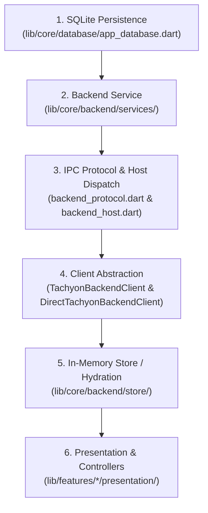

# Contributing to Tachyon

Thank you for your interest in contributing to **Tachyon**! Tachyon is a modern, ultra-optimized, studio-grade music player engineered in Flutter and Dart with native C audio FFI (`miniaudio_player`).

To preserve Tachyon's exceptional responsiveness, architectural cleanliness, and zero-compromise performance, all contributors (including automated coding assistants and AI agents) are expected to read and adhere strictly to these guidelines.

---

## 📋 Table of Contents

- [Contributing to Tachyon](#contributing-to-tachyon)
  - [📋 Table of Contents](#-table-of-contents)
  - [🤝 Code of Conduct](#-code-of-conduct)
  - [💡 Project Philosophy \& Architectural Foundations](#-project-philosophy--architectural-foundations)
  - [🛑 Strict Architectural Invariants](#-strict-architectural-invariants)
    - [1. Decoupled Dual-Isolate Architecture](#1-decoupled-dual-isolate-architecture)
    - [2. In-Memory Relational Graph \& Pointer Identity](#2-in-memory-relational-graph--pointer-identity)
    - [3. Anti-Regression Policy on Domain Models](#3-anti-regression-policy-on-domain-models)
    - [4. Lightweight IPC: File Paths Only](#4-lightweight-ipc-file-paths-only)
    - [5. Strict Internationalization (i18n) Rules](#5-strict-internationalization-i18n-rules)
  - [🛠️ Step-by-Step Feature Implementation Workflow](#️-step-by-step-feature-implementation-workflow)
  - [💻 Local Development \& Environment Setup](#-local-development--environment-setup)
    - [Prerequisites](#prerequisites)
    - [Initial Setup](#initial-setup)
  - [✅ Quality Gates \& Verification](#-quality-gates--verification)
  - [🚀 Submitting a Pull Request](#-submitting-a-pull-request)

---

## 🤝 Code of Conduct

All contributors and participants agree to abide by our [Code of Conduct](CODE_OF_CONDUCT.md). Please maintain a welcoming, inclusive, and professional environment across all issues, pull requests, and discussions.

---

## 💡 Project Philosophy & Architectural Foundations

Tachyon is built on five unwavering engineering principles:

1. **Zero Bloat & Peak Native Performance:** Zero external CLI subprocesses (`ffmpeg`, `ffprobe`, etc.). All audio decoding, crossfading, and DSP effects run via native FFI bindings (`miniaudio_player`).
2. **60/120 FPS UI Fluidity:** The Main UI Isolate must never drop frames (0 jank). All SQLite access, directory crawling, tag parsing, and image scaling happen strictly in dedicated background isolates.
3. **Ultra-Lean Resource Usage:** In minimized mode, CPU usage drops to 0.0% on Linux and under 0.8% on Windows with less than 10 MB RAM, verified through hardware-level performance monitoring.
4. **Relational Memory Efficiency:** The catalog exists as a single hydrated graph in memory. No duplicated entity models.
5. **Strict Internationalization:** Zero hardcoded strings in visible UI widgets.

---

## 🛑 Strict Architectural Invariants

Before writing or modifying any code, familiarize yourself with these critical rules. PRs violating these invariants will not be merged.

### 1. Decoupled Dual-Isolate Architecture

The application is physically split across isolates:

```raw
┌──────────────────────────────────────────────────────────┐
│                   MAIN ISOLATE (UI)                      │
│  - Widgets (Material 3), Theme & State Management        │
│  - Presentation Controllers (ChangeNotifier)             │
│  - In-Memory Graph (LibraryStore)                        │
│  - CERO direct SQLite access, CERO direct audio engines  │
└──────────────────────────┬───────────────────────────────┘
                           │ TachyonBackendClient
                           ▼ (Typed IPC)
┌──────────────────────────────────────────────────────────┐
│              CORE BACKEND HOST (ISOLATE)                 │
│  - AppDatabase (SQLite via direct sqlite3 FFI)           │
│  - AudioEngineService (miniaudio_player + DSP suite)     │
│  - MetadataService (haudiotagger + Worker Isolates)      │
│  - MetadataUtils (Disk-cached PNG LQ/MQ/HQ thumbnails)   │
│  - QueueManager (Playback queue & shuffle engine)        │
│  - LyricsService (Hierarchical resolution & SQLite cache)│
└──────────────────────────────────────────────────────────┘
```

- **Main UI Isolate:**
  - Never imports or instantiates `AppDatabase`.
  - Never manages audio playback FFI handles.
  - Never decodes images via heavy Dart packages or parses raw ID3 tags.
- **Backend Host Isolate:**
  - Manages SQLite persistence, playback state, lyrics resolution, and audio engine pipelines.
  - Communicates with UI exclusively via `TachyonBackendClient`.

### 2. In-Memory Relational Graph & Pointer Identity

Tachyon represents the local music library as an in-memory unified relational graph within `LibraryStore`:

- If the library contains 1,000 tracks and 200 artists, there are **exactly 1,000 `Track` instances and 200 `Artist` instances** in memory.
- Related entities reference each other through **direct memory pointers**:

  ```dart
  identical(trackA.artists[0], trackB.artists[0]) == true;
  identical(album.tracks.first.album, album) == true;
  ```

- **$O(1)$ Instant UI Traversal:** UI widgets must never query SQLite or run linear scans (`.where(...)`) for common relational lookups. Access `album.tracks`, `artist.albums`, or `track.album` directly.

### 3. Anti-Regression Policy on Domain Models

> [!CAUTION]
> **NEVER REINTRODUCE FLAT STRING OR ID FIELDS IN DOMAIN ENTITIES.**

When refactoring or updating screens:

- **`Track`** MUST NOT have: `artist`, `album`, `artistName`, `albumArtist`, `artistId`, `albumId`, `lyrics`, or `List<String> artists`. It references `List<Artist> artists` and `Album? album`.
- **`Album`** MUST NOT have: `artistName` or `artistId`. It references `List<Artist> artists` and `List<Track> tracks`.
- **`PlaylistEntry`** MUST NOT duplicate metadata. It references `Track? track`.
- **UI Adapts to Domain:** If a legacy widget expects `track.artistName`, update the widget to compute or format it:

  ```dart
  // Correct:
  final artistDisplay = track.artists.map((a) => a.name).join(', ');
  ```

### 4. Lightweight IPC: File Paths Only

- When transferring album covers or thumbnails between isolates, **always send disk file paths (`String`)**, **never raw byte buffers (`Uint8List`)**.
- Cover art is cached on disk by `MetadataUtils` in three lossless Skia-compressed PNG resolutions:
  - **HQ (800x800):** _Now Playing_ full-screen view.
  - **MQ (250x250):** Album grid cards and OS notifications.
  - **LQ (50x50):** Dense track lists and tiles.

### 5. Strict Internationalization (i18n) Rules

Every visible string (labels, tooltips, buttons, dialog titles, error messages) must go through the i18n engine:

1. **Add key and English string** to [`i18n/en.jsonc`](file:///mnt/Proyectos/tachyon/i18n/en.jsonc) (canonical fallback).
2. **Add Spanish translation** to [`i18n/es.jsonc`](file:///mnt/Proyectos/tachyon/i18n/es.jsonc).
3. **Declare strongly-typed getter** in `AppStringKey` inside [`lib/features/locales/domain/locale.dart`](file:///mnt/Proyectos/tachyon/lib/features/locales/domain/locale.dart).
4. **Register the key** in `AppStringKey._allAppStrings`.
5. **Consume in widgets** using:

   ```dart
   context.watch<LocaleController>().localeStrings.<keyName>
   ```

---

## 🛠️ Step-by-Step Feature Implementation Workflow

When introducing new features or modifying existing behavior, follow Tachyon's bottom-up layered architecture:



1. **Database Layer:** Add schema tables, indexes, or queries in `AppDatabase`. Keep `AppDatabase` clean, transactional, and concise (< 650 lines).
2. **Service Layer:** Implement business logic in `lib/core/backend/services/`. Do not import visual Flutter widgets here.
3. **Protocol Layer:** Define message DTOs in `backend_protocol.dart` and register request dispatchers in `CoreBackendHost` (`backend_host.dart`).
4. **Backend Client:** Expose client methods in `TachyonBackendClient` and implement them in `DirectTachyonBackendClient` (for unit testing) and isolate RPC handlers.
5. **Store / Domain Layer:** Update entity models or hydration logic in `LibraryStore` while preserving memory pointer identity.
6. **Presentation Layer:** Update UI controllers and widgets.
   - **Important:** Do NOT change existing constructor signatures for controllers in `lib/features/*/presentation/` to avoid breaking dependency injection in `main.dart` or integration tests.

---

## 💻 Local Development & Environment Setup

### Prerequisites

- **Flutter SDK:** Flutter 3.13+ (Channel stable) with Dart SDK ^3.13.3.
- **C/C++ Build Essentials:**
  - **Linux:** `build-essential`, `pkg-config`, `libasound2-dev`, `libdbus-1-dev`
  - **Windows:** Visual Studio 2022 with Desktop development with C++
  - **macOS:** Xcode Command Line Tools

### Initial Setup

1. **Clone the repository:**

   ```bash
   git clone https://github.com/chomusuke-mk/tachyon.git
   cd tachyon
   ```

2. **Install Flutter dependencies:**

   ```bash
   flutter pub get
   ```

3. **Run the application:**

   ```bash
   # On Linux
   flutter run -d linux

   # On Windows
   flutter run -d windows

   # On Android
   flutter run -d android
   ```

---

## ✅ Quality Gates & Verification

Before submitting any code, verify that all quality gates pass:

1. **Static Analysis (Zero tolerance for errors or warnings):**

   ```bash
   dart analyze .
   ```

   _Expected output:_ `No issues found!`

2. **Automated Test Suite:**

   ```bash
   flutter test
   ```

   _Expected output:_ All unit and widget tests pass (100% success rate).

3. **Code Formatting:**

   ```bash
   dart format --output=none --set-exit-if-changed .
   ```

---

## 🚀 Submitting a Pull Request

1. **Branch Naming:** Create a focused topic branch:
   - `feature/add-equalizer-preset`
   - `fix/lyrics-scrolling-jank`
   - `refactor/metadata-worker-pool`
2. **Commit Hygiene:**
   - Keep commits small, descriptive, and atomic.
   - Write clear commit messages in English using imperative mood (e.g., `Add True-Peak limiter curve selector`, `Fix memory leak in thumbnail generator`).
3. **Automated Agents & Bots Notice:**
   - Autonomous agents must strictly adhere to the project's **Golden Rule**: never execute mutating git commands (`git add`, `git commit`, `git push`, etc.) directly on the user's workspace without explicit direction.
4. **PR Description:**
   - Summarize the changes and the architectural rationale.
   - Reference any related issues (`Fixes #42`).
   - Confirm that `dart analyze .` reports 0 issues and `flutter test` passes.
   - Include screenshots or screen recordings for visual UI modifications.

Thank you for helping make Tachyon the fastest, most refined music player available!
