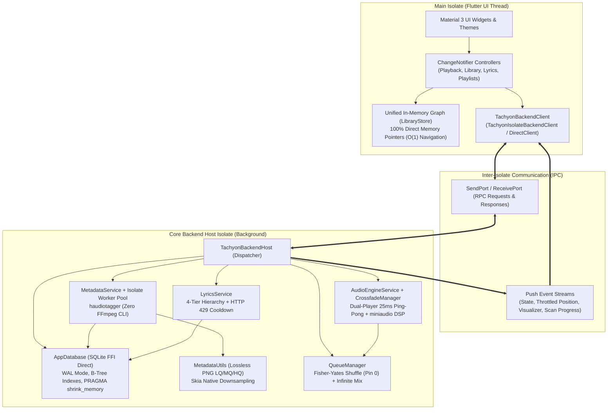
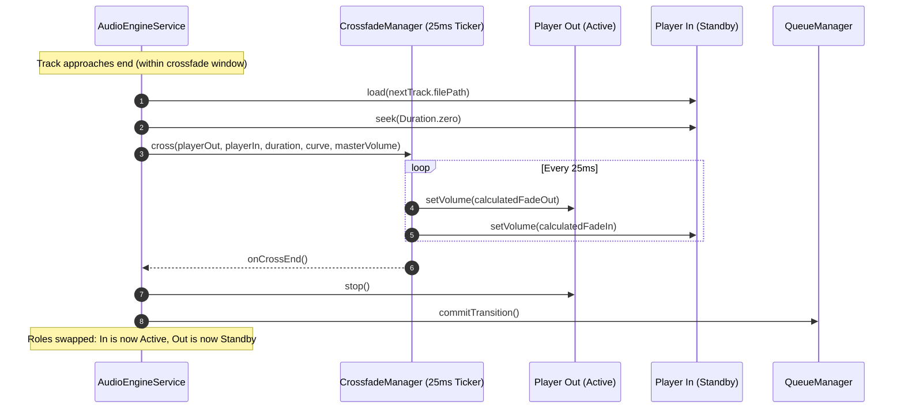
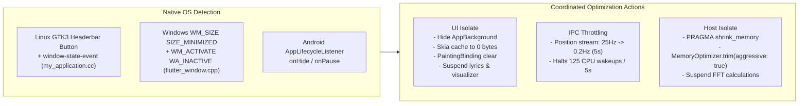

# 🏛️ Tachyon Architecture Specification (`ARCHITECTURE.md`)

This document provides an exhaustive technical specification of the architecture, design patterns, subsystem boundaries, data flows, and performance guarantees of the **Tachyon Music Player**.

---

## 1. High-Level Architectural Overview

Tachyon is built upon an architectural decoupling model that strictly separates the visual rendering and user interaction thread (**UI Isolate**) from the compute-heavy, real-time background services thread (**Core Backend Host Isolate**).



---

## 2. Decoupled Isolate Responsibilities

### 2.1 The UI Isolate (Main Thread)

The UI Isolate is dedicated exclusively to delivering a jank-free 60/120 FPS user experience:

- **Zero Direct Database Access:** Never executes SQLite queries. It receives a flat snapshot (`CatalogSnapshot`) at startup and maintains all relationships in memory.
- **Zero Direct Audio FFI:** Audio playback and native C handles are never accessed directly from the UI.
- **Zero Image Tag Decoding:** Tag extraction and raw image decoding are never run on the main isolate.
- **High-Frequency Position Handling:** Real-time playback position ticks (25 Hz) are bound to `playbackController.positionListenable` (`ValueNotifier<Duration>`) so that progress bars repaint without triggering builds across parent widgets.

### 2.2 The Core Backend Host Isolate

The background host isolate encapsulates all resource-intensive operations:

- **Persistence (`AppDatabase`):** Direct FFI bindings via `package:sqlite3` (no `sqflite`), operating transactionally with WAL mode.
- **Audio DSP Engine (`AudioEngineService`):** Two native player instances coordinated with a 25ms crossfade volume ticker and studio DSP effects.
- **Concurrent Metadata Workers (`MetadataService`):** Worker isolates created via `Isolate.spawn` scaled to `Platform.numberOfProcessors`.
- **Stateless Cover Storage (`MetadataUtils`):** Disk-cached PNGs hashed with SHA-256 in three standard resolutions.

---

## 3. Unified In-Memory Relational Graph (`LibraryStore`)

To eliminate relational lookup overhead and avoid redundant object allocations, the UI isolate reconstructs the entire library into a bidirectional graph in $O(N)$ time.

### 3.1 Pointer Identity Invariant

Every entity exists exactly **once** in RAM:

- Multiple songs belonging to an artist contain direct references to that single `Artist` instance.
- Navigating `album.tracks`, `artist.albums`, or `track.album` is an immediate $O(1)$ memory pointer dereference.
- Identity assertions hold true across the runtime:

  ```dart
  identical(trackA.artists.first, trackB.artists.first) == true // when sharing an artist
  identical(album.tracks.first.album, album) == true
  ```

### 3.2 Single-Pass $O(N)$ Hydration Algorithm

When `CatalogSnapshot` arrives from the backend isolate:

1. Many-to-many associations (`track_artists`, `track_genres`) are grouped by `trackId`.
2. `Artist` and `Genre` instances are instantiated with mutable backing lists.
3. `Album` instances are instantiated, linking their primary `Artist` reference and mutable track lists.
4. `Track` instances are created with direct pointers to their `Album`, `List<Artist>`, and `List<Genre>`.
5. Backing lists for albums and artists are populated with track references.
6. `Playlist` and `PlaylistEntry` instances are constructed, pointing directly to hydrated `Track` objects.
7. Unmodifiable views (`UnmodifiableListView`, `UnmodifiableSetView`) are lazily cached.

---

## 4. Audio Engine & Studio DSP Pipeline

### 4.1 Dual-Player Ping-Pong Crossfade

`AudioEngineService` orchestrates two instances of `AudioPlayerAdapter` (`_playerA` and `_playerB`), alternating roles between `_activePlayer` and `_standbyPlayer`:



### 4.2 Studio-Grade DSP Effects Suite

Built upon native C FFI bindings in [`miniaudio_player`](https://pub.dev/packages/miniaudio_player):

- **Bauer Crossfeed (`bs2b`):** Blends high-frequency spatial separation to eliminate acoustic fatigue during headphone listening (_Chu Moy_ 700Hz/6dB, _Default_ 700Hz/4.5dB).
- **10-Band Graphic Equalizer:** Direct biquad peaking filters centered across ISO frequencies: 31Hz, 62Hz, 125Hz, 250Hz, 500Hz, 1kHz, 2kHz, 4kHz, 8kHz, 16kHz (-24 dB to +24 dB).
- **Freeverb Algorithmic Reverb:** 8 parallel comb filters + 4 all-pass diffusers with configurable _Room Size_, _Damping_, _Width_, and _Wet/Dry_ mix.
- **Stereo Spatializer:** Mid-side matrix manipulation scaling side-channel energy (0.0x mono to 2.0x wide).
- **True-Peak Limiter:** Lookahead peak detection preventing digital clipping.
- **ReplayGain & Volume Normalization:** Track gain and peak scaling with optional preamp.
- **Pitch and Speed:** Independent time-stretching and pitch shifting via Sonic integration.

---

## 5. Metadata Processing & Thumbnail Pipeline

### 5.1 Concurrency Model (`Isolate.spawn`)

- Mass scanning delegates work to persistent worker isolates proportional to `Platform.numberOfProcessors`.
- **Zero FFmpeg:** Tag extraction utilizes native `haudiotagger` bindings in C/Rust.
- Workers write extracted image files directly to disk cache and return lightweight `ExtractedTrackData` metadata records. Zero byte arrays are sent across isolate ports.

### 5.2 Triple-Quality Lossless PNG Cache

`MetadataUtils` manages three fixed-dimension caches keyed by SHA-256 hash:

1. **HQ (800x800):** Decoded at high resolution, cropped to square, used exclusively for the active _Now Playing_ backdrop.
2. **MQ (250x250):** Downsampled in GPU canvas from HQ, used for album/artist grid cards and OS media notifications.
3. **LQ (50x50):** Downsampled from MQ, used for dense track list rows and mosaic tiles.

---

## 6. On-Demand Lyrics Subsystem

### 6.1 4-Tier Resolution Hierarchy

Lyrics are resolved using a strict priority cascade:

1. **Embedded:** Audio file tags (`USLT`/`LYRICS`) extracted during library scans.
2. **File:** Contiguous `.lrc`/`.LRC` files discovered on local disk.
3. **Primary Remote:** `lrclib.net` (provides synchronized timestamps and plain text).
4. **Secondary Remote:** `lyrics.ovh` (fallback plain text).

### 6.2 Strict On-Demand Lifecycle

- **Zero Background Pre-fetching:** Lyrics are queried **only** when `LyricsView` mounts (`_showLyrics == true`).
- **Defensive Rate Limiting:**
  - 500ms request pacing.
  - HTTP 429 `Retry-After`: Live countdown with automatic retry if $\le 10$s; instant fallback to `lyrics.ovh` if $> 10$s.
  - Generation token tracking cancels stale in-flight queries when skipping tracks rapidly.

---

## 7. Performance & Minimized Mode Architecture

To achieve an ultra-low resource profile (<0.8% CPU and <10 MB RAM on Windows; 0.0% CPU at idle on Linux), Tachyon executes coordinated multi-tier optimizations:



### 7.1 Low-Level Native Memory Trimming (`MemoryOptimizer`)

- **Windows:** Binds to `kernel32.dll` to invoke `HeapCompact(heap, 0)` and `SetProcessWorkingSetSize(GetCurrentProcess(), -1, -1)`.
- **Linux:** Binds to `libc.so` to invoke `malloc_trim(0)` and iterates `/proc/self/maps` applying `madvise(MADV_DONTNEED)` on clean file-backed pages and `MADV_PAGEOUT` on cold anonymous pages.
- **Android:** Invokes Bionic Scudo `mallopt(_mDecayTime, 0)`, `_mPurge`, `_mPurgeAll`, and POSIX `madvise`.

---

## 8. Operating System Integration

Tachyon provides complete, native OS media integration:

- **Linux:** `LinuxMprisBridge` registers on D-Bus under `org.mpris.MediaPlayer2.tachyon` implementing `org.mpris.MediaPlayer2` and `org.mpris.MediaPlayer2.Player`.
- **Windows:** `WindowsSmtcBridge` integrates with the Windows Runtime System Media Transport Controls (`smtc_windows`).
- **Android:** `TachyonAudioHandler` manages a persistent Foreground Service with interactive notifications and lock screen media playback (`package:audio_service`).
